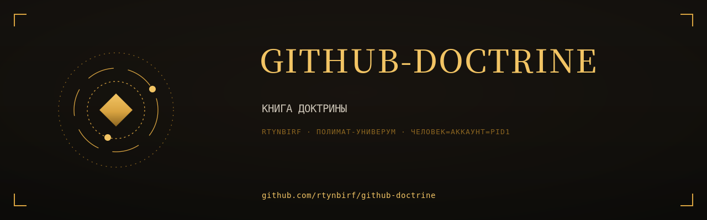

# КНИГА ДОКТРИНЫ

  

> Собрана 2026-11-11 из 2 репозиториев аккаунта rtynbirf. Каждая глава — снимок `main` оригинала на дату сборки (см. `PROVENANCE.md` внутри главы). Оригиналы архивированы read-only, история коммитов сохранена там.

## Оглавление

| Глава | Источник | Файлов | Коммитов в ориг. | Снимок |
|---|---|---|---|---|
| [repo-doctrine](glavy/repo-doctrine/) | [оригинал](https://github.com/rtynbirf/repo-doctrine) | 80 | 140 | `86ef81c` |
| [github-runbook](glavy/github-runbook/) | [оригинал](https://github.com/rtynbirf/github-runbook) | 119 | 159 | `28d0795` |

## О чём эта книга

Книга: доктрина GitHub одним томом — настройка репозиториев человеком для человека + ранбук всех флагов. Собрано из 2 репозиториев rtynbirf.

## Как читать

Каждый каталог в `glavy/` — самостоятельная глава со своим README (если оно было в оригинале). Оглавление главы не переименовывалось: имена совпадают с именами исходных репозиториев, чтобы работали старые ссылки в документах.
